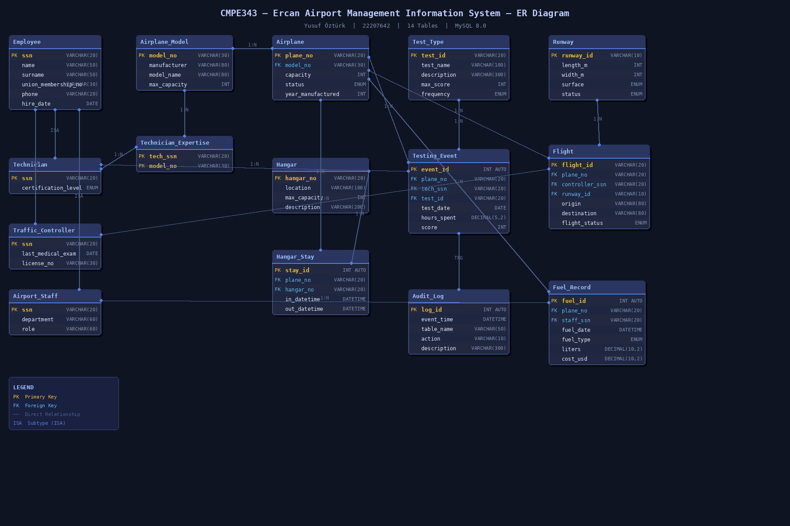
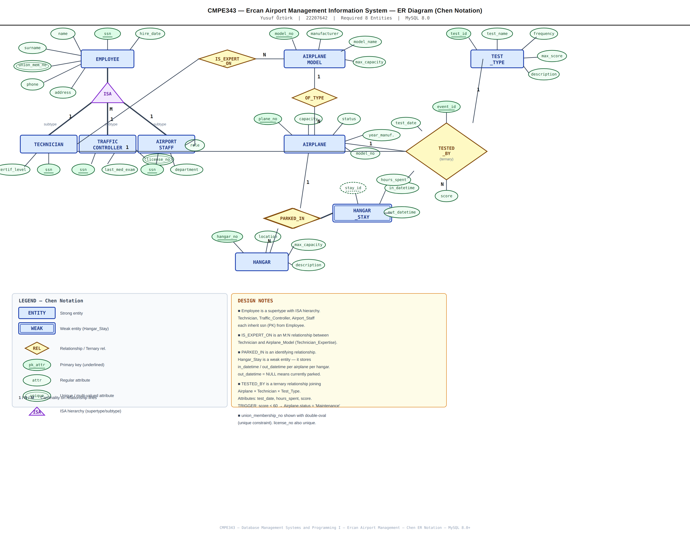

# Ercan Airport Management Information System


A relational database for Ercan Airport (ECN) in North Cyprus, built in MySQL as my term project for CMPE343 Database Management Systems and Programming I at Cyprus International University.

It covers the airplane fleet and its models, hangar check-in and check-out history, three types of employees, technician expertise, airworthiness tests, flights, runways and fuel records.



## Highlights

- 15 tables (14 core tables plus an audit log), with a supertype/subtype (ISA) design for employees: one `Employee` table plus `Technician`, `Traffic_Controller` and `Airport_Staff` sharing its key
- 3 views for hangar occupancy, the employee roster and airplane health
- 3 triggers: a test score below 60 moves the airplane to `Maintenance`, hangar stays cannot end before they start, and every new test is written to `Audit_Log`
- 3 stored procedures for an airplane's test history and for hangar check-in and check-out
- 15 management queries using joins, `GROUP BY` / `HAVING`, `CASE`, correlated `NOT EXISTS` subqueries and date functions

## Quick setup

```bash
# 1. Create the database, tables, views, triggers and stored procedures
mysql -u root -p < 01_DDL.sql

# 2. Insert sample data
mysql -u root -p < 02_DML.sql

# 3. Run the 15 management queries
mysql -u root -p airport_mgmt < 03_Queries.sql
```

## Files

| File | Description |
|------|-------------|
| `01_DDL.sql` | 15 tables, 3 views, 3 triggers, 3 stored procedures |
| `02_DML.sql` | Sample data (12 employees, 10 airplanes, 20 test events, 6 flights and more) |
| `03_Queries.sql` | 15 statistical management queries |
| `04_Report.md` | Full project report: assumptions, relational model and query walkthrough |
| `ERD_AirportManagement.png` | ER diagram with keys, types and relationships |
| `ERD_Chen.png` | ER diagram (Chen notation) |

## Schema

**Tables:** Employee, Technician, Traffic_Controller, Airport_Staff, Airplane_Model, Technician_Expertise, Airplane, Hangar, Hangar_Stay, Test_Type, Testing_Event, Runway, Flight, Fuel_Record, Audit_Log

**Views:** `vw_hangar_occupancy`, `vw_employee_roster`, `vw_airplane_health`

**Triggers:** `trg_low_score_maintenance`, `trg_check_stay_dates`, `trg_audit_test_event`

**Stored procedures:** `sp_airplane_test_history`, `sp_hangar_checkin`, `sp_hangar_checkout`

<details>
<summary>ER diagram in Chen notation</summary>



</details>
